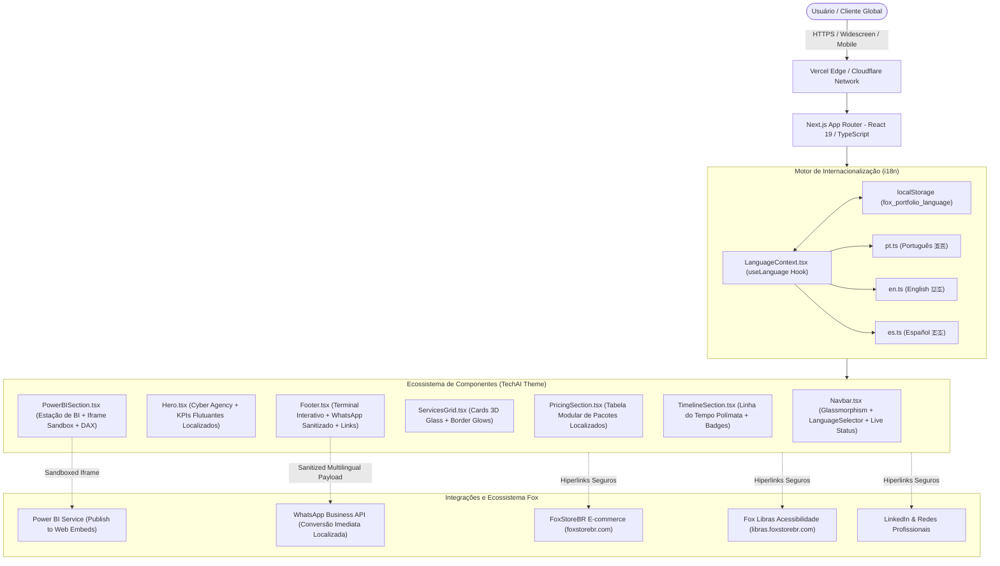

# Arquitetura do Sistema — https://portfolio.foxstorebr.com
# Portfólio Executivo Multidisciplinar — Osvaldo Queta Fernando

> **Documento de Arquitetura de Software, Design System e Internacionalização (i18n)**
> Versão: 1.1.0 | Padrão: TechAI Dark Executive / Cyberpunk High-Conversion
> Atualizado em: 30/10/2026

---

## 1. Visão Geral e Objetivos do Ecossistema

O domínio principal `https://portfolio.foxstorebr.com` foi concebido para posicionar **Osvaldo Queta Fernando** como uma autoridade técnica global de alto nível em **Business Intelligence / Power BI**, **Engenharia de Software Full Stack & IA**, **Consultoria Estratégica & Governança de TI**, **Gestão de E-commerce / Redes** e **Acessibilidade Corporativa em Libras**.

### 1.1. Metas Arquiteturais
- **Conversão Agressiva & Credibilidade Imediata:** Interface no estilo "TechAI - Startup & IT Agency", transmitindo autoridade com mais de 16 anos de experiência.
- **Soberania Multilíngue (i18n Nativo):** Suporte inicial completo a 3 idiomas com troca instantânea e sem recarregamento:
  - 🇧🇷 **Português (Brasil - PT-BR)**
  - 🇺🇸 **Inglês (United States - EN-US)**
  - 🇪🇸 **Espanhol (España - ES-ES)**
- **Interatividade Real em Business Intelligence:** Demonstração prática e responsiva de dashboards do Power BI (Publish to Web) com seletores de cenários de negócios (Financeiro, Vendas, Supply Chain), métricas DAX e auditoria de dados.
- **Performance de Elite (Core Web Vitals):** LCP < 1.2s, CLS = 0, zero gargalos na thread principal.
- **Navegação Fluida no Ecossistema:** Interligação direta entre o portfólio (`portfolio.foxstorebr.com`), a loja comercial (`foxstorebr.com`) e a iniciativa social de acessibilidade (`libras.foxstorebr.com`).

---

## 2. Diagrama de Arquitetura e Fluxo de Dados



---

## 3. Arquitetura do Sistema de Internacionalização (i18n)

### 3.1. Estrutura Modular em `lib/i18n/`
- `types.ts`: Tipagem estrita da interface `Dictionary` garantindo que nenhuma chave ou texto fique ausente em qualquer idioma.
- `dictionaries/pt.ts`: Dicionário completo em Português do Brasil.
- `dictionaries/en.ts`: Dicionário completo em Inglês executivo.
- `dictionaries/es.ts`: Dicionário completo em Espanhol corporativo.
- `LanguageContext.tsx`: Provedor de contexto React (`LanguageProvider`) com hook `useLanguage()`, detecção de idioma via `navigator.language`, persistência em `localStorage` e sincronização automática do atributo `<html lang="...">`.
- `LanguageSelector.tsx`: Componente visual com bandeiras dos países (🇧🇷, 🇺🇸, 🇪🇸) integrado na Navbar desktop e no menu drawer mobile.

---

## 4. Design System & Tokens Visuais (FOXTECH Institutional Benchmark)

### 4.1. Paleta de Cores Oficial FOXTECH
| Token | Hex | Uso Principal |
| :--- | :--- | :--- |
| **Fundo Principal** | `#080B12` | Fundo principal da página e body |
| **Fundo dos Cards** | `#11141F` | Superfícies de cards, painéis e elementos glassmorphic |
| **Laranja Principal** | `#FF6800` | Cor primária FOXTECH (Logotipo, ícones, destaques, bordas luminosas) |
| **Laranja Secundário** | `#FF3600` | Gradientes de botões primários e feixes diagonais |
| **Branco** | `#FFFFFF` | Títulos principais, logotipo `FOX` e botão de telefone |
| **Texto Secundário** | `#A8AFB8` | Subtítulos, descrições e listas de serviços |
| **Cinza Secundário** | `#687280` | Metadados, numeração discreta e copyright |

### 4.2. Pasta de Identidade Visual (`public/branding/foxtech/`)
- `foxtech-logo-primary.svg` / `.png`: Logo principal com símbolo, divisória, `FOXTECH` e slogan.
- `foxtech-logo-horizontal.svg` / `.png`: Logo horizontal padrão.
- `foxtech-logo-header.svg` / `.png`: Versão horizontal compacta para navegação.
- `foxtech-logo-footer.svg` / `.png`: Versão para rodapé com slogan horizontal.
- `foxtech-icon.svg` / `.png` & `favicon.svg`: Símbolo isolado da cabeça da raposa.
- `foxtech-logo-white.svg` / `.png`: Versão monocromática branca.
- `foxtech-logo-black.svg` / `.png`: Versão monocromática preta.
- `foxtech-logo-orange.svg` / `.png`: Versão monocromática laranja.

### 4.2. Efeitos e Texturas
- **Hello Watermark:** Texto `Hello` gigante em caixa-alta na fonte monoespaçada translúcida (`text-white/[0.04]`) no fundo do Hero.
- **Portrait Cutout Overlap:** Retrato executivo em estúdio de alta fidelidade sobreposto ao `Hello` com máscara de fusão na base.
- **TechAI Orange Strip:** Faixa contínua em `#FF5722` com 4 grandes contadores e textura sutil.
- **Circular Portfolio Badge:** Emblema circular centralizado em laranja com microlinhas concêntricas dividindo os cards do portfólio.
- **Pill Buttons:** Botões de ação em formato de pílula arredondada (`rounded-full`) com ícone circular interno e setas de avanço `>>`.

### 4.3. Tipografia
- **Display / Títulos:** Sans-serif geométrica moderna (Space Grotesk / system-ui) com `tracking-tight` e palavras-chave destacadas em `#FF5722`.
- **Monospace (Técnico):** JetBrains Mono para KPIs, números de experiência, fórmulas DAX e tags de tecnologia.

---

## 5. Árvore de Componentes e Responsabilidades

```
root/
├── next.config.ts     # Configuração do Turbopack com regras de loaders CSS
├── postcss.config.mjs # Plugin @tailwindcss/postcss para compatibilidade total de compilação
app/
├── layout.tsx         # Configuração de HTML, fontes, metadados SEO, JSON-LD Schema e ClientProviders
├── page.tsx           # Orquestrador da Landing Page (Navbar -> Hero -> StatsBanner -> About -> Services -> PowerBI -> Works -> Pricing -> Timeline -> CtaBanner -> Footer)
└── globals.css        # Variáveis CSS, animações de scanline, dot-grid, scrollbar customizada

components/
├── ClientProviders.tsx # Encapsulador de contexto de cliente (LanguageProvider)
├── LanguageSelector.tsx# Seletor de idiomas com bandeiras (🇧🇷 PT, 🇺🇸 EN, 🇪🇸 ES) e animação glassmorphic
├── Navbar.tsx         # Menu flutuante fixo no padrão TechAI com logo OQF, links, bandeiras e pílula de telefone
├── Hero.tsx           # Hero section com marca d'água "Hello", foto executiva sobreposta, bio à esquerda e badges flutuantes à direita
├── StatsBanner.tsx    # Faixa horizontal contínua em #FF5722 com 4 contadores executivos de alto impacto
├── AboutSection.tsx   # Seção "Digital Experiences With 16+ Years Of Purpose" + Download CV + barras animadas de proficiência
├── ServicesGrid.tsx   # Grade de serviços no padrão Home-3 ("Designing Digital Experiences That Feel Effortless") + botões Explore Now >>
├── PowerBISection.tsx # Estação de Business Intelligence futurista com seletor de dashboards, DAX code view e telemetria
├── WorksSection.tsx   # Portfólio de 6 projetos reais com o distintivo emblema circular "Portfolio" no centro
├── PricingSection.tsx # Tabela modular de pacotes executivos (Start, Enterprise, Sistemas/MVP, Squad Contínuo)
├── TimelineSection.tsx# Trajetória acadêmica e liderança técnica em formato cronológico refinado
├── CtaBanner.tsx      # Banner pré-footer "Elevate Your Project Together!" com foto do especialista e botão "Let's Talk >>"
└── Footer.tsx         # Terminal interativo de contato (envio direto ao WhatsApp), links do ecossistema e copyright

lib/
└── i18n/
    ├── types.ts           # Interfaces estritas de dicionários e idiomas
    ├── index.ts           # Registro de dicionários e lista de opções com bandeiras
    ├── LanguageContext.tsx# React Context, Provider e hook useLanguage
    └── dictionaries/
        ├── pt.ts          # Dicionário Português (Brasil) 🇧🇷
        ├── en.ts          # Dicionário Inglês (United States) 🇺🇸
        └── es.ts          # Dicionário Espanhol (España) 🇪🇸
```

---

## 6. Estratégia de Iframe Sandboxing & Resiliência do Power BI

O componente `PowerBISection.tsx` adota uma abordagem de nível empresarial:
1. **Seletor de Abas Dinâmico com Tradução:**
   - **Financeiro & DRE Dinâmico (Finance & P&L / Financiero y DRE):** Margem EBITDA, Realizado vs. Orçado (*Budget vs. Actual*).
   - **Vendas & Performance E-commerce (Sales & E-commerce / Ventas y E-commerce):** LTV, CAC, Ticket Médio, Curva ABC de produtos.
   - **Supply Chain & Estoque (Supply Chain & Inventory / Cadena de Suministro):** Giro de estoque, ruptura e lead time.
2. **Scanline Skeleton Loader:** Laser animado contínuo durante o carregamento de relatórios públicos (*Publish to Web*).
3. **Alternador de DAX & Star Schema:** Inspeção técnica de código em tempo real.
4. **Controles de Estação:** Alternador de tela cheia (*fullscreen*) e botão de recarregamento de telemetria.
